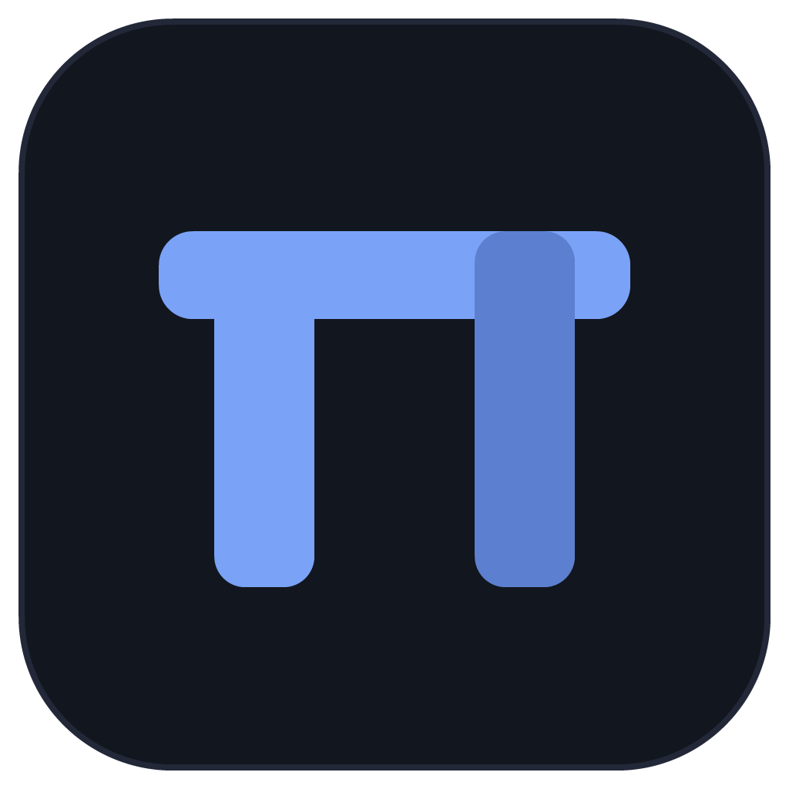

<div align="center">



# n47-pi-deck (fork of pi-deck)

**Desktop client for the [pi coding agent](https://github.com/earendil-works/pi)**
Sessions grouped by project, live subagent runs, and a transcript that reads like documentation.

[](LICENSE)

[Build](#build) · [Features](#features) · [Shortcuts](#shortcuts) · [How it works](#how-it-works) · [Development](#development)

</div>

---

pi-deck is a window for the `pi` you already have. It does not ship an agent, a server or a
copy of pi: it spawns your `pi` over the RPC/JSONL protocol (`pi --mode rpc`) and renders
`~/.pi/agent` as a desktop application — Tauri 2 with the system webview (WebKitGTK,
WebView2, WKWebView), no Electron.

## Build

This fork is built locally — no releases, no installers.

### Requirements

- **Rust** (stable) + **Node.js 22+**
- **`pi` 1.4+** on `PATH` — the app never installs or updates pi by itself
- Linux only: `libwebkit2gtk-4.1`, `libsoup-3.0`, `gtk+-3.0`, `librsvg2`

### Steps

```bash
npm install                 # root (tauri cli) and ui/ (vite, svelte, sass)
npm run build               # builds ui/dist, then the app binary
./src-tauri/target/release/pi-deck
```

`npm run build` runs the whole pipeline: the front-end is compiled by Vite into
`ui/dist/` (via `beforeBuildCommand`), then Tauri compiles the Rust shell with those
assets embedded — the result is a single self-contained binary. Bundling is disabled
(`bundle.active: false` in `src-tauri/tauri.conf.json`), so nothing beyond the binary
is produced.

## Features

**Sessions**

- Grouped by project, read from `~/.pi/agent/sessions`; a session started without a project
  lives under `sem projeto` (`cwd = $HOME`).
- Collapsible tree, per-project `+` to start a session in that folder, per-session rename-free
  delete that moves the `.jsonl` **and** its subagent runs to a trash folder.
- Tabs per open session; switching reloads the transcript from disk.

**Transcript**

- Markdown rendered from DOM (headings, lists, tables, code fences with language, quotes, links).
- One compact card per tool call: icon (`✓`/`✕`/`•`), elapsed time, collapsible output.
- Thinking blocks collapsed by default; tool outputs truncated at 20 KB with a counter.
- History is paginated: last 250 messages / 1 MB, with a `carregar anteriores` bar.
- Floating `↓` to jump back to the end, and new content never yanks you while you read.

**Agents**

- Subagents of the _current_ session only, live (decoded from the `PI_SUBAGENT_ASYNC_JSON:`
  widget) and historical (from `<session>/<childId>/run-N/session.jsonl`). Click one to open
  its transcript.
- Banner when `pi-subagents` didn't load, instead of a silently empty panel.

**Model, thinking, context**

- Model picker with search, grouped by provider, showing context size; instant on boot from
  `pi --list-models`, refined by RPC.
- Thinking as inline level bars; manual compaction (`⤓`) and auto-compaction toggle; reload button.
- Context chip (`47% · 474k/1M`) with a popover: window usage, compaction state, cache read/write,
  input/output, cost and message count. The "Compactar em" selector picks the context limit where pi
  compacts (70–95%); it writes `compaction.modelOverrides[<model>].reserveTokens` to the **project's**
  `.pi/settings.json` and applies on the next reload (`↻`). Untouched by default — the pi default stands.

**Commands and auth**

- Type `/` for a palette of everything the session exposes: skills (`skill:*`), extension commands,
  prompt templates — plus pi's own commands, routed by the app: `/compact`, `/model`, `/thinking`,
  `/new`, `/name`, `/session`, `/copy`, `/export`, `/abort`, `/login`.
- `/login` or the auth chip opens the provider list (44 known to the CLI, marking which have models
  and which are ready); logging in opens a terminal with `pi auth login <provider>` and the app
  polls `pi auth check` until it turns ready.

**Packages and MCP**

- Catalog of npm packages with the `pi-package` keyword (name, version, monthly downloads),
  with `instalar` / `remover` behind a confirmation that shows the exact command.
- MCP servers listed with state, scope, transport and tool count; add (stdio command or HTTP
  URL, `--env`, `--header`) and remove — always through `pi mcp`, never editing JSON by hand.

**Extras**

- `pi` version and provider auth state in the sidebar footer, live process counter.
- Optional hook instrumentation: writes a small extension that logs every hook invocation.

## Shortcuts

| Key          | Action                        |
| ------------ | ----------------------------- |
| `Ctrl+Enter` | send message                  |
| `Ctrl+B`     | show/hide the subagents panel |
| `Esc`        | close the model picker        |

## How it works

```
pi-deck (Rust + WebView)                 your pi
├─ reads ~/.pi/agent/sessions            ├─ pi --mode rpc (1 process per active session)
├─ reads <session>/<childId>/run-N/      ├─ get_messages / get_state / get_available_models
├─ reads ~/.pi/agent/missions            ├─ set_model / set_thinking_level / compact
└─ writes nothing except trash + hooks   └─ pi install / pi remove / pi mcp ...
```

Three deliberate rules:

1. **Opening a session is read-only.** No process is spawned; the transcript comes from the
   `.jsonl`. `pi` starts only when you send a message or change model — with a cap of
   **3 live processes** (oldest is stopped) and all of them killed when the window closes.
2. **Payloads are bounded.** A 22 MB session is served as the last 250 messages within a
   1 MB budget, 64 KB per message line. This is why a long session opens instantly instead of
   freezing the webview.
3. **The CLI is the only writer.** Packages, MCP servers and updates go through
   `pi install|remove|mcp|update`, never direct edits of `settings.json`/`mcp.json`. Every
   write shows the exact command before running it.

## Where things live

| Path                                                        | What                                       |
| ----------------------------------------------------------- | ------------------------------------------ |
| `~/.pi/agent/sessions/<project>/<session>.jsonl`            | session transcript (pi's own file)         |
| `~/.pi/agent/sessions/<project>/<session>/<childId>/run-N/` | subagent runs                              |
| `~/.pi/agent/sessions/<project>/.pi-deck-trash/`            | deleted sessions (restore by moving back)  |
| `~/.pi/agent/extensions/pi-deck-hooks.js`                   | optional hook logger written by the app    |
| `~/.pi/agent/pi-deck/hooks.log`                             | hook log (only when instrumentation is on) |

## Settings

`⚙` in the header:

- **Ferramentas expandidas** — tool cards start open
- **Thinking expandido** — thinking blocks start open
- **Mostrar projetos ocultos** — unhide projects hidden with `⊘`
- **Instrumentar hooks** — installs/removes the hook logger extension
- **Pacotes e MCP** — installed packages, npm catalog, MCP servers, hooks log
- **Atualizar extensões / pi** — runs `pi update --extensions` / `--self`

## Development

```bash
npm install
npm run dev      # tauri dev (Vite HMR on :1420)
npm run build    # app binary at src-tauri/target/release/pi-deck
npm run dev:ui   # front-end only: vite dev server, no Rust
cargo test --manifest-path src-tauri/Cargo.toml   # payload budget test
```

Debug flags (env): `PWUI_DEBUG=1` logs every RPC line to stderr, `PWUI_AUTONEW=1` opens a
new session on start.

## Known limitations

- Session tabs are not persisted across restarts; switching tabs reloads from disk, so
  in-flight text from an inactive tab is not replayed.
- `tool_call` / `model_select` hooks are logged only when they actually fire.
- Machine-translated UI: the interface is in Brazilian Portuguese.

## License

MIT — see [LICENSE](LICENSE).
