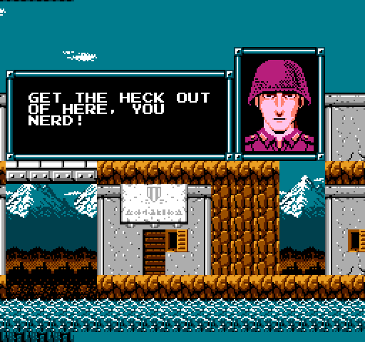

# PI-PI-PI

**Desktop client for the [pi coding agent](https://github.com/earendil-works/pi)**
Sessions grouped by project, live subagent runs, and a transcript that reads like documentation.

This is a hard, early fork of matheusbbdutra/pi-deck (now [sightdeck](https://github.com/matheusbbdutra/sightdeck)).

This is stripped down and purely for my own use, but if you want to dig into it, it's licensed appropriately, of course.

## License

MIT — see [LICENSE](LICENSE).
